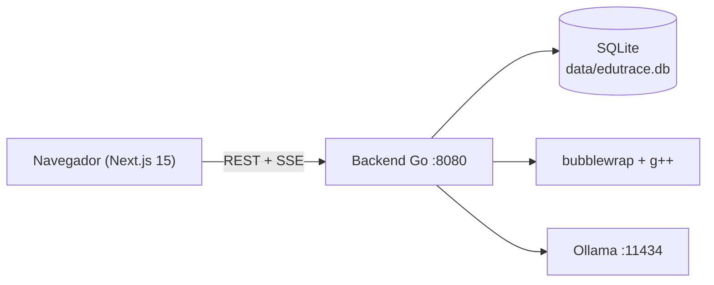

# EduTrace

Plataforma de retroalimentación formativa para **Introducción a la Programación (C++)**. El estudiante escribe y compila su código en el navegador. Cada entrega se ejecuta con los casos de prueba del profesor, y una IA local (Ollama) prepara una propuesta de retroalimentación que el profesor revisa, edita, aprueba o descarta antes de que llegue al estudiante.

> EduTrace no califica sola. La IA propone; la decisión final siempre es del profesor.

## Qué hace

**Estudiante**
- Editor C++ con compilación y ejecución aisladas (`g++ -std=c++17` dentro de `bubblewrap`), con entrada estándar.
- Talleres con enunciado, archivos, fecha límite y casos de prueba: al compilar ve qué casos pasa; de los ocultos, solo si pasan.
- Si no compila o falla al ejecutar, ve en español qué significa cada error y en qué línea, sin usar la IA.
- Agrega sus propios casos de prueba, que corren con los del profesor y se guardan en su navegador.
- Practica con un banco de 14 ejercicios que se corrigen solos, y ve su progreso: notas, niveles por RAE y ejercicios resueltos.
- Entregas oficiales y su historial, con la revisión del profesor, el nivel por RAE y quién la aprobó.
- Puede preguntar sobre cada retroalimentación y responder si la entendió.
- Si la clase está en modo inmediato, también puede pedir retroalimentación formal o informal, pistas graduadas (de la más general a la más concreta, sin la solución) y chatear con un tutor de IA (hasta `AI_REQUESTS_PER_HOUR` pedidos por hora).
- Recibe avisos en la campana, y por correo si lo permite, cuando le devuelven o actualizan una revisión, le responden una pregunta o un monitor comenta su código.

**Profesor**
- Materias, clases con código de ingreso, talleres, casos de prueba y los 4 RAE oficiales del curso 33698.
- Cola automática: cada entrega oficial recibe una propuesta de la IA, con nota tentativa, niveles por RAE y una estimación de minutos de revisión.
- Panel de revisión para editar, aprobar o descartar la propuesta, con su historial en la bitácora. Con rúbrica de puntajes, la nota se calcula sola. Atajos: `Ctrl+S` guarda, `Ctrl+Enter` aprueba y devuelve, `Alt+↓` va a la siguiente entrega por revisar.
- En la clase:
  - modo de IA (supervisado o inmediato);
  - indicadores de tiempos, cola y comprensión con sus metas;
  - tiempo estimado de revisión por taller;
  - errores frecuentes;
  - diagrama de rendimiento por RAE;
  - exportación de notas y revisiones en CSV.
- Responde las preguntas de los estudiantes, y recibe un aviso si la IA falla.
- Marca un taller como **evaluación**: hasta su fecha límite, los estudiantes de la clase no pueden usar la IA ni el chat.
- Genera un código de un solo uso para que un estudiante que olvidó la contraseña la restablezca.
- Comparte la materia con otros profesores y la copia para el siguiente periodo (clases, talleres, casos, rúbricas y RAE).
- Ve **alertas tempranas** (talleres vencidos sin entregar, inactividad, muchos errores seguidos, nivel bajo en RAE), detecta **código similar** entre entregas y genera un **reporte por estudiante** listo para imprimir o guardar en PDF.
- **Cierra el periodo** de una materia: ya no recibe entregas ni inscripciones y sus datos se borran solos después del plazo de conservación (`RETENTION_DAYS`).

**Monitor**
- Ve las entregas de las clases asignadas, comenta y marca el código, y responde preguntas. No califica.

**IA**
- Modelo local por Ollama (por defecto `llama3.1:8b`). Ningún dato sale del servidor y el modelo nunca recibe el nombre ni el email del estudiante.
- La retroalimentación sigue las tres preguntas de Hattie y Timperley e incluye observaciones de legibilidad, mantenibilidad y documentación. Si el modelo omite algo, se completa solo.
- Un filtro impide que la respuesta incluya la solución del ejercicio.
- Cada propuesta guarda qué modelo y qué versión del prompt la generó; la clase muestra cuántas propuestas de cada modelo se aprobaron sin cambios, se editaron o se descartaron.

## Arquitectura



Es un monolito modular en Go:

| Paquete | Qué hace |
|---|---|
| `cmd/server` | Punto de entrada |
| `internal/handler` | HTTP, cola de propuestas y gzip |
| `internal/auth` | Acceso a datos y reglas de permisos en SQL |
| `internal/ai` | Prompts, filtro anti-solución, secciones y calidad |
| `internal/compiler` | Sandbox y casos de prueba |
| `internal/mail` | Envío de avisos por SMTP |
| `internal/backup` | Respaldo cifrado, verificación y restauración de `data/` |
| `internal/practice` | Banco de ejercicios de práctica |
| `internal/similarity` | Detección de código similar |
| `internal/config` | Variables de entorno |

El frontend está en `web/`.

## Requisitos

- Go 1.26 o superior.
- Node.js 20 o superior y npm.
- `g++`, `bubblewrap` 0.8 o superior, y `prlimit` y `choom` (paquete `util-linux`).
- Ollama con el modelo `llama3.1:8b`. Se recomienda GPU: cada propuesta tarda unos 25 s.

## Inicio rápido

```bash
cp .env.example .env
./start.sh
```

En `.env`, define `TEACHER_CODE`: es el código para crear cuentas de profesor.

`start.sh`:
- verifica las dependencias;
- descarga el modelo si falta;
- levanta el backend en `http://127.0.0.1:8080` y el frontend en `http://localhost:3000`.

`start.sh` reinstala las dependencias del frontend y reconstruye su caché solo cuando cambian; `./start.sh --limpio` la borra a la fuerza.

Para cargar datos de prueba (un profesor, 5 estudiantes, talleres y entregas):

```bash
./scripts/seed_test_data.sh
```

Las cuentas y el detalle están en [docs/TEST_DATA.md](docs/TEST_DATA.md).

## Configuración (`.env`)

| Variable | Por defecto | Para qué |
|---|---|---|
| `PORT` / `HOST` | `8080` / `127.0.0.1` | Dirección del backend |
| `ALLOWED_ORIGINS` | `http://localhost:3000` | Orígenes del frontend permitidos (CORS) |
| `DATA_DIR` | `data` | Base SQLite y adjuntos (fuera de git) |
| `TEACHER_CODE` | vacío | Código para registrar profesores; vacío = deshabilitado |
| `COOKIE_SECURE` | `false` | `true` en producción con HTTPS |
| `SANDBOX` | `bwrap` | `none` solo para desarrollo |
| `COMPILE_TIMEOUT_SECS` / `RUN_TIMEOUT_SECS` | `10` / `5` | Límites de compilación y ejecución |
| `OLLAMA_BASE_URL` | `http://localhost:11434` | Servidor de Ollama |
| `OLLAMA_MODEL` | `llama3.1:8b` | Modelo |
| `OLLAMA_CONTEXT_SIZE` | `6144` | Contexto del modelo |
| `OLLAMA_TIMEOUT` | `180` | Segundos máximos por respuesta |
| `PUBLIC_URL` | el primero de `ALLOWED_ORIGINS` | Dirección pública, para los enlaces de los correos |
| `TRUST_PROXY` | `false` | `true` detrás de Caddy, para usar la IP real del estudiante |
| `MAX_SANDBOXES` | núcleos de la CPU | Programas que compilan o corren a la vez |
| `AI_REQUESTS_PER_HOUR` | `20` | Pedidos a la IA por estudiante y por hora; `0` sin límite |
| `RETENTION_DAYS` | `180` | Días que se conservan los datos de un periodo cerrado; `0` no borra nada |
| `DISK_MIN_FREE_PERCENT` | `10` | Por debajo, `/api/health` avisa |
| `SMTP_HOST`, `SMTP_PORT`, `SMTP_USER`, `SMTP_PASSWORD`, `SMTP_FROM` | vacío, `587` | Avisos por correo; sin `SMTP_HOST` solo hay avisos en la plataforma |
| `BACKUP_DIR`, `BACKUP_KEEP`, `RESPALDO_REMOTO` | `respaldos`, `14`, vacío | Respaldos diarios |
| `BACKUP_RECIPIENT`, `BACKUP_IDENTITY` | vacío | Clave pública con la que se cifran los respaldos, y archivo de la clave privada para restaurarlos |
| `ALERTA_URL`, `ALERTA_JSON`, `LATIDO_URL` | vacío | Alertas de `scripts/vigilar.sh` |

## Pruebas, CI y CD

```bash
go test ./...
cd web && npx tsc --noEmit && npm run lint && npm run build
```

GitHub Actions corre esas mismas pruebas en cada *push* y pull request, además de `govulncheck`, `npm audit` y una revisión de accesibilidad WCAG 2.1 AA con axe sobre la aplicación funcionando (`.github/workflows/ci.yaml`). Cuando pasan en `main`, despliega en el servidor con `scripts/desplegar.sh`, que vuelve a la versión anterior si algo falla (`.github/workflows/cd.yaml`). La preparación del servidor, HTTPS, respaldos y alertas están en [docs/DESPLIEGUE.md](docs/DESPLIEGUE.md).

## Scripts

| Script | Para qué |
|---|---|
| `scripts/seed_test_data.sh` | Datos de prueba |
| `scripts/seed_rae_levels.py` | Carga los RAE oficiales y los niveles en una base que ya tenía datos de prueba |
| `scripts/prueba_carga.py N` | Envía N entregas y mide cuánto tarda la cola (RNF-10) |
| `scripts/medir_ancho_banda.py` | Peso de las páginas y de la API (RNF-12) |
| `scripts/desplegar.sh [commit]` | Despliega en el servidor y vuelve atrás si falla |
| `scripts/respaldar.sh` | Respalda y verifica `data/`, y borra los respaldos antiguos |
| `scripts/restaurar.sh archivo` | Restaura un respaldo y vuelve atrás si EduTrace no arranca |
| `scripts/vigilar.sh` | Revisa la salud de EduTrace y envía alertas |
| `scripts/limpiar_historial.sh` | Quita del historial de git una carpeta subida por error |
| `go run ./cmd/aieval` | Compara modelos de IA con casos de evaluación |

## Documentación

- [docs/RNF_COMPLIANCE.md](docs/RNF_COMPLIANCE.md): matriz de cumplimiento de los requisitos.
- [docs/POLITICA_DATOS.md](docs/POLITICA_DATOS.md): qué datos se tratan y qué recibe la IA.
- [docs/INTEGRACION.md](docs/INTEGRACION.md): integración con Campus Virtual (pendiente).
- [docs/TEST_DATA.md](docs/TEST_DATA.md): datos de prueba.
- [docs/DESPLIEGUE.md](docs/DESPLIEGUE.md): CI, CD, preparación del servidor, HTTPS, sandbox, respaldos, alertas y correo.

## Herramientas de seguimiento de grupos (Python)

`src/classroom`, `src/telegram`, `src/rag`, `requirements.txt` y el workflow `.github/workflows/jirafales.yaml` no forman parte de EduTrace, y el CI no los revisa. Son las herramientas de x19marlon para seguir los repositorios de los grupos del curso:
- el workflow corre cada lunes, analiza los commits de cada grupo y guarda los reportes en MongoDB;
- el bot de Telegram consulta esos reportes.
